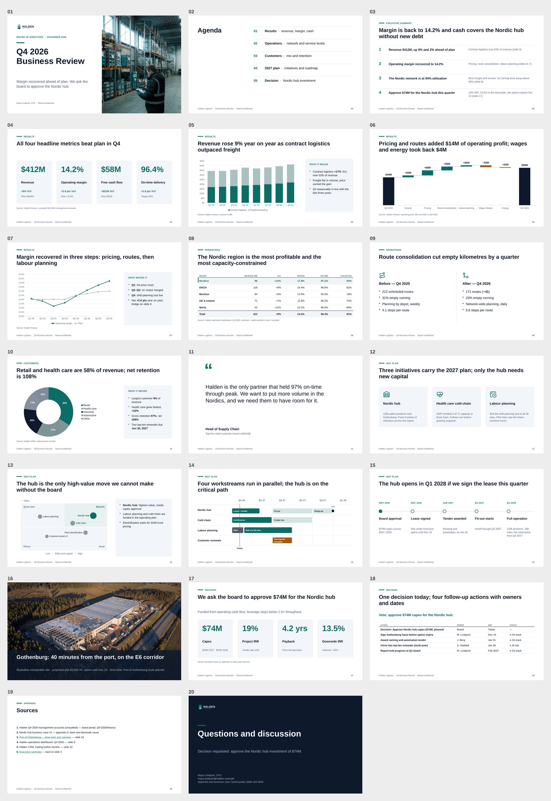
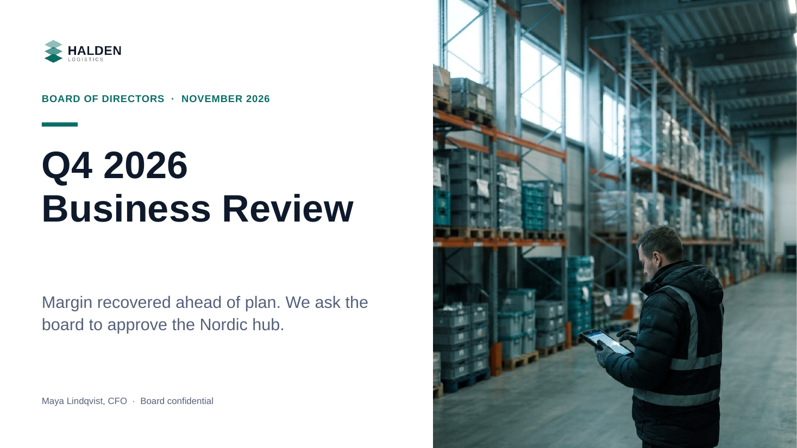
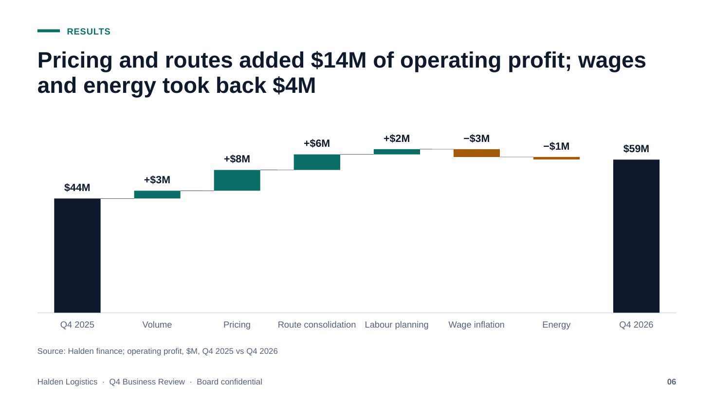
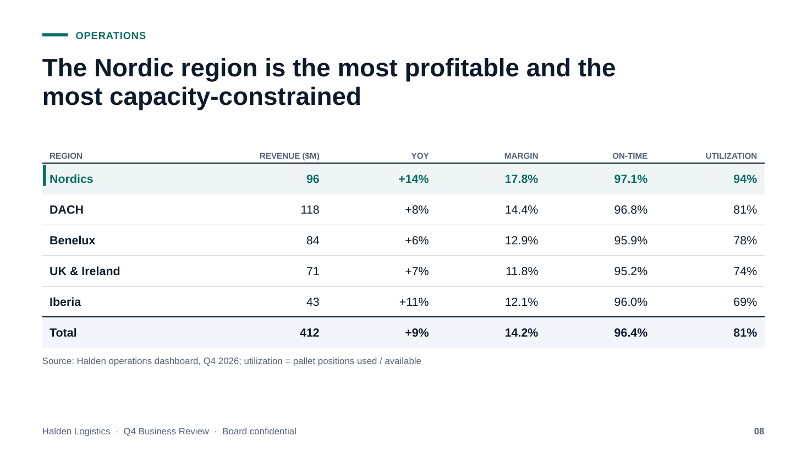
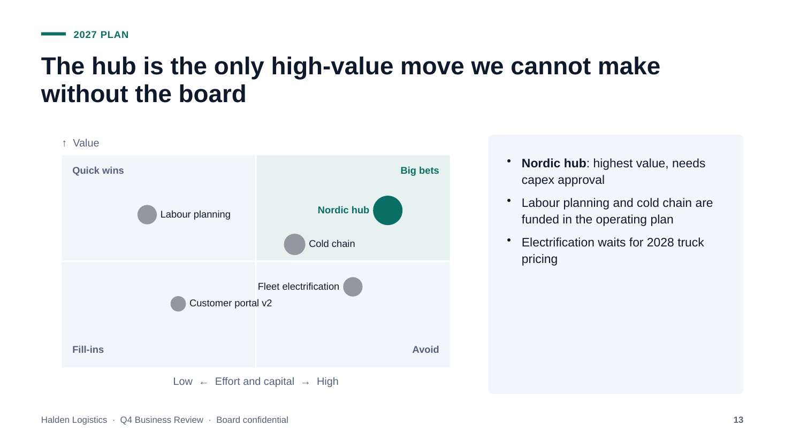
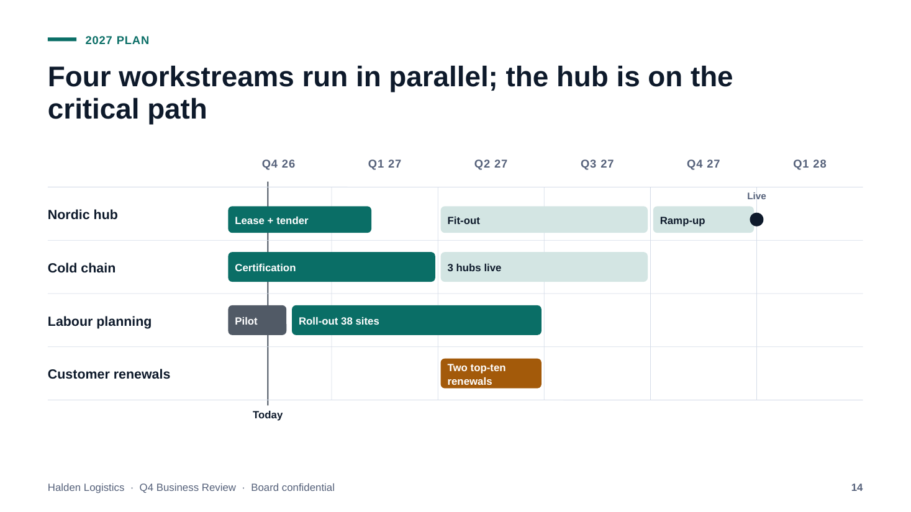
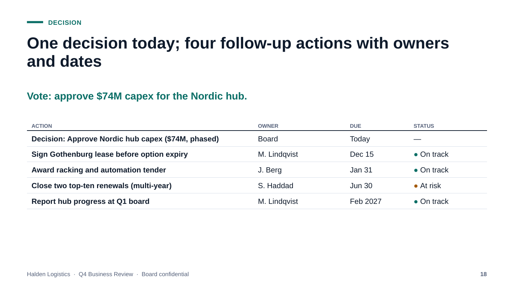

# PowerPoint Factory

[](https://github.com/sebyx07/power-point-factory/actions/workflows/ci.yml) [](LICENSE) [](.dz/README.md)

**Corporate-ready PowerPoint presentations as code — written by AI, proven by QA, reviewed with fresh eyes.**

Developers (and their Claude agents) describe slides as small typed recipes. The factory turns them into **native, fully editable `.pptx`** (real shapes, charts, tables, speaker notes, slide titles, transitions and animations), renders every slide to PNG + PDF, and runs ~40 automatic checks — text overflow, contrast, overlaps, slop words, chart rules, broken links — before anyone sees it. AI images, video and music come from [Kubeez](https://kubeez.com).

From the everyday status update to the launch keynote: same recipes, different motion profile.



> **See the result without building anything:** [`board-update.pptx`](out/halden/q4-business-review/2026-11-03/board-update/board-update.pptx) · [`board-update.pdf`](out/halden/q4-business-review/2026-11-03/board-update/board-update.pdf) · [slide PNGs](out/halden/q4-business-review/2026-11-03/board-update/slides/) — a 20-slide Q4 board review for _Halden Logistics_ (a fictional company), with real Kubeez photography.

|                                                                                |                                                                                |                                                                                |
| ------------------------------------------------------------------------------ | ------------------------------------------------------------------------------ | ------------------------------------------------------------------------------ |
|  |  |  |
| Cover with generated photo + logo                                              | Waterfall bridge (native shapes)                                               | Native table, highlight + total rows                                           |
|  |  |  |
| 2×2 prioritization matrix                                                      | Gantt roadmap with "today" line                                                | Decisions: action · owner · date · RAG                                         |

## Quickstart

```sh
git clone <this repo> && cd power-point
bin/setup                       # bun install, .env, checks LibreOffice + poppler + fonts
bin/deck loop                   # build + QA + screenshots of the sample → out/halden/…
bin/deck new acme q1-review board-update --theme ledger
claude                          # then: /deck acme "Q1 board review — revenue 2M, +11%…"
```
Needs [Bun](https://bun.sh) ≥ 1.4, LibreOffice (headless render), poppler (`pdftoppm`) and the metric-compatible fonts Carlito/Caladea/Liberation/Gelasio. `bin/doctor` prints every missing piece with its install command. Add `KUBEEZ_API_KEY` to `.env` for AI media; without it you get labeled placeholders and everything else still works.

## How it works

```
presentations/<company>/<project>/<date>/<deck>/      out/<company>/<project>/<date>/<deck>/
  deck.ts          meta + theme                       <deck>.pptx    native, editable
  slides/01-*.ts   one slide per file (typed DSL)  →  <deck>.pdf
  assets/          your files + Kubeez cache          slides/<deck>-NN.png · <deck>-contact-sheet.png
                                                      <deck>-qa.md · -outline.md · -scene.json · export/
     recipe → layout → scene graph → assets → pptxgenjs → OOXML motion → LibreOffice → PNG → QA
```
A slide is data:
```ts
// presentations/halden/q4-business-review/2026-11-03/board-update/slides/06-margin-bridge.ts
import { slide } from "@/slide";

export default slide({
  layout: "waterfall",
  eyebrow: "Results",
  title: "Pricing and routes added $19M of operating profit; wage inflation took back $6M",
  steps: [
    { label: "Q4 2025", value: 46, total: true },
    { label: "Pricing", value: 9 },
    { label: "Route consolidation", value: 6 },
    { label: "Wage inflation", value: -6 },
    { label: "Q4 2026", value: 55, total: true },
  ],
  prefix: "$",
  suffix: "M",
  source: "Halden finance; operating profit, $M",
  notes: "The operational levers more than offset wage inflation.",
});
```
Every company gets a brand brain — `presentations/<company>/BRAND.md` (voice, logo rules, colors, approved facts), `brand.ts` (tokens), `brand/` (logos, reusable photos with a license manifest) and optional `layouts/`.

## What's inside

|                       |                                                                                                                                                                                                                                                                                    |
| --------------------- | ---------------------------------------------------------------------------------------------------------------------------------------------------------------------------------------------------------------------------------------------------------------------------------- |
| **23 layouts**        | cover · agenda · section · summary · bullets · twoColumn · cards · quote · bigNumber · stats · chart · waterfall · table (RAG + harvey balls) · matrix · process · timeline · roadmap · imageFull · video · nextSteps · references · closing · custom — [catalog](docs/layouts.md) |
| **Native charts**     | column, bar, stacked, line, area, pie, doughnut — editable in PowerPoint, one-accent highlighting, number formats                                                                                                                                                                  |
| **Motion profiles**   | `none` · `subtle` (default) · `build` (click reveals) · `keynote` (Morph) — [motion](docs/motion.md)                                                                                                                                                                               |
| **Real slide titles** | title placeholders → outline view, navigation and screen readers work                                                                                                                                                                                                              |
| **Links**             | `[text](https://…)` and `[jump](#slide:12)` inside any text; `references` layout                                                                                                                                                                                                   |
| **Text engine**       | Office-safe fonts measured with metric-twin fonts → wrap/auto-fit matches PowerPoint                                                                                                                                                                                               |
| **4 themes + brands** | cobalt · ledger · graphite · terracotta, all WCAG-AA tested; `extendTheme` per company                                                                                                                                                                                             |
| **Kubeez media**      | images, cut-outs, video, music; cached by prompt hash, committed, never billed twice — [API](docs/kubeez.md) · [prompts](docs/image-prompts.md)                                                                                                                                    |
| **QA**                | static + PPTX + rendered-pixel + baseline-diff checks, each with a fix — [rules](docs/qa.md)                                                                                                                                                                                       |
| **Extensible DSL**    | primitives (`el.text`, `el.rect`, `columns`…), `defineLayout`, `use(myLayout, props)` — [extending](docs/extending.md)                                                                                                                                                             |

## Commands

```sh
bin/deck new <company> <project> <deck> [--theme …] [--date YYYY-MM-DD]
bin/deck loop   [deck]          # build + QA + screenshots + what to look at next
bin/deck qa     [deck|all]      # --fast (skip render) · --strict (warnings fail)
bin/deck watch  [deck]          # rebuild on save
bin/deck export [deck]          # QA-gated, client-ready "Company - Title - date.pptx/.pdf"
bin/deck approve [deck]         # accept screenshots as visual baseline
bin/deck list | open
bin/kubeez models | balance | generate | status | upload | remove-bg | brand-set
bin/check                       # the gate (== CI): biome, tsc, guards, tests, every deck through QA
```

## AI-first

Built for Claude Code (works with any agent that reads `AGENTS.md`):
- [`CLAUDE.md`](CLAUDE.md) — rules, commands, the deck loop. `AGENTS.md` → symlink.
- `/deck <company> <brief>` — brief → ghost deck → recipe → QA loop → fresh-eyes review → export.
- `/review-deck` — independent verdict from screenshots.
- Agents `deck-reviewer` (story + design) and `brand-reviewer` (claims vs `BRAND.md`); skills `onboard-company`, `add-layout`, `kubeez-media`. See [`.claude/README.md`](.claude/README.md).
- [`llms.txt`](llms.txt) for any LLM landing in the repo.

## Docs

[deck craft](docs/deck-craft.md) · [layouts](docs/layouts.md) · [image prompts](docs/image-prompts.md) · [Kubeez API](docs/kubeez.md) · [motion](docs/motion.md) · [QA](docs/qa.md) · [extending](docs/extending.md) · [libraries](docs/libraries.md)

## Outputs and git

`out/` is gitignored for your decks. The **Halden sample's** `.pptx`, `.pdf` and PNGs are the one exception (whitelisted in `.gitignore`) so you can see what the factory produces. Generated Kubeez media in `presentations/**/assets/generated/` _is_ committed — it is source, and regenerating costs credits.

## Contributing
Issues and PRs welcome — this repo is **AI-maintained** by [developerz.ai](https://developerz.ai): an agent triages, reviews and merges on a green `CI OK` ([`.dz/`](.dz/README.md)). See [CONTRIBUTING.md](CONTRIBUTING.md) · [SECURITY.md](SECURITY.md) · [CHANGELOG.md](CHANGELOG.md).

MIT licensed. Halden Logistics is fictional; its logo and photos were made for this repo.
